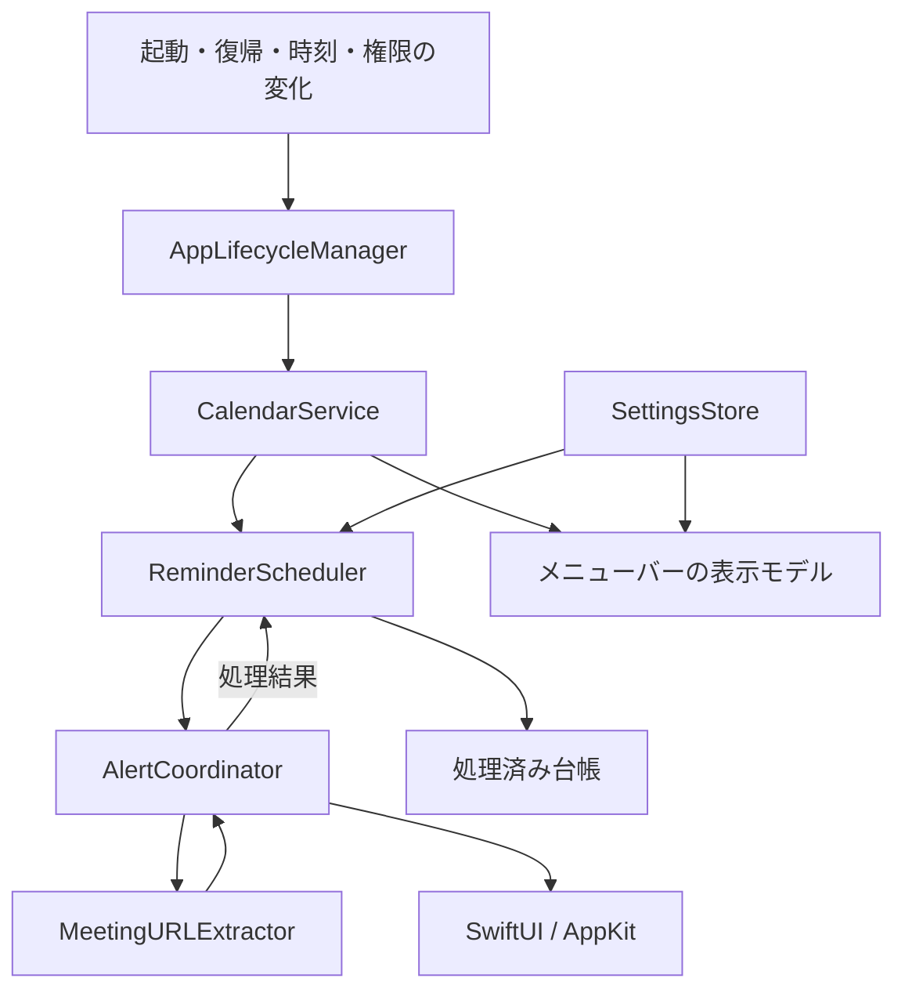

# アーキテクチャ

本書は[要件](requirements.md)を満たす製品の実装方針です。`InMyFace.xcodeproj`に開始1分前通知・Dismissの最小実装があります。MeetingURLExtractor・音・ログイン起動は未実装です。独立したEventKit検証アプリを`Prototypes/EventKitProbe/`に配置しています。

最小実装はAppLifecycleManagerが具象サービスを組み立て、CalendarServiceの同期取得をMainActor上で直列実行します。ReminderSchedulerはDate・値型Snapshot・処理済みキー・有効状態だけから表示バッチと次期限を計算し、AppKitや実時計へ依存しません。次期限・表示中の終了時刻・30分の保守更新のうち最も早い時刻にTimerを1本設定し、発火時は再取得します。EventKit変更通知は500msで集約し、復帰・画面復帰・アクティブ化・日付・時計・タイムゾーン変更も再取得の契機とします。非同期取得・世代管理は未実装で、長時間の同期取得がUIを止める可能性は残っています。

AlertCoordinatorは表示状態を共有し、既存パネルのViewを更新します。開始時刻を過ぎても、表示済みの回は終了まで維持し、開始後2分の救済閾値を再適用して閉じません。Dismiss時は全画面で同じ回を除去し、他の回は残します。表示中の一時停止・スリープ・画面スリープ・ユーザーセッション切替ではパネルを閉じ、復帰時は救済規則で再評価します。セッション通知を確実なロック検出とは扱いません。

スリープ・画面スリープ・非アクティブセッション・終了は独立した停止理由として保持し、対応する復帰だけで解除します。起動時は設定ウィンドウを開いてから通知評価を開始し、即時表示するアラートのキー対象を設定画面へ戻さない順序にします。

検証アプリは`CalendarProbe`が単一のEKEventStoreをMainActor上で所有し、権限要求・カレンダー選択・一日単位の取得を扱います。取得結果は値型Snapshotへ変換し、`ProbeView`へ渡します。初期選択はなし、権限がFull Access以外ならキャッシュと選択を破棄します。変更通知・アプリの再アクティブ化・スリープ復帰・手動更新時に権限を再確認します。通知・台帳・製品のCalendarServiceは含まず、識別子を画面表示して手動検証する構成です。

## 全体構成と依存関係

単一プロセスのメニューバーアプリとし、Appの組み立て箇所で具象型を生成します。時計と予定取得境界だけを小さな差し替え可能なインターフェースにし、汎用イベントバスやDIフレームワークを導入しません。



| コンポーネント | 責務と境界 |
| --- | --- |
| CalendarService | 単一EKEventStoreを所有。権限確認、カレンダー列挙、期間指定取得、変更監視。取得結果を値型EventSnapshotへ変換する。予定は編集しない。 |
| ReminderScheduler | 対象判定、時刻計算、並び替え、次のタイマー1本、回ごとの状態と台帳を管理。AppKitへ依存しない。 |
| AlertCoordinator | MainActorで表示バッチ、全画面のウィンドウ、音、フォーカスを管理。操作結果をSchedulerへ返し、状態を画面ごとに持たない。 |
| MeetingURLExtractor | URL・場所・メモを入力する副作用なしの抽出・検証。候補とサービス名を返す。通信やURLのオープンを行わない。 |
| SettingsStore | UserDefaultsに設定とスキーマ版を保持。ログイン起動の希望値とOS状態を混同しない。 |
| AppLifecycleManager | 起動、復帰、ロック解除、時刻・画面構成変化を集約。取得と再評価を要求し、ServiceManagementも扱う。 |

## ディレクトリ構成と拡張予定

```text
InMyFace/
  App/          # エントリーポイント、組み立て、Lifecycle
  Models/       # EventSnapshot、OccurrenceKey、設定、処理状態
  Services/     # Calendar、Scheduler、URL抽出、Settings
  Views/        # MenuBar、Settings、Alert
  Windows/      # AlertCoordinator、NSPanel管理
  Resources/    # Info.plist、entitlements、音、アセット
InMyFaceTests/  # Scheduler、URL、設定・台帳テスト
InMyFaceUITests/ # 操作テスト。OSの表示制御は実機検証を併用
```

アプリバンドルと署名はXcodeで管理します。SPMパッケージの作成はテストや再利用上の必要が生じるまで保留します。

## 取得から表示までのフロー

1. 起動時に設定と処理済み台帳を読み、権限を確認。未許可ならユーザー操作を通じて要求する。
2. 許可時にカレンダーを列挙し、選択された予定を取得。当日一覧用と通知用の期間の和集合を取得する。通知用は「現在−2分〜現在＋48時間」を初期案とする。
3. 期間検索で繰り返し回を展開した結果を受け、開始時刻で明示ソート。独自の繰り返し計算や識別子だけの再検索に依存しない。
4. Snapshotと設定から通知日時を計算し、処理済み・終日・キャンセル等を除外。次の期限にタイマーを1本設定する。
5. 発火時に再取得して削除・変更を確認し、最新世代の結果で期日到来分をバッチ化する。UIはMainActorで表示し、音はバッチ単位で再生する。
6. Join成功またはDismissを台帳へ記録して全ウィンドウへ反映。全件が閉じられたらウィンドウとカウントダウンを破棄する。

変更通知は個別差分ではないため再取得します（[公式資料](https://developer.apple.com/documentation/eventkit/ekeventstorechangednotification)）。連発時は500ms程度で集約する初期案とし、発火時の再確認は遅延させません。取得は直列化し、世代番号で古い非同期結果が新しい設定を上書きすることを防ぎます。EventKitのオブジェクトは所有する実行コンテキスト内で完結させます。

## 通知スケジューリングと状態

回ごとの状態は「予約／表示中／処理済み／対象外」です。表示中も台帳とは別に保持し、再評価による二重表示を防ぎます。一時停止・ロック時は表示を閉じ、処理済みにはせず、復帰後にREL-01で評価します。起動・復帰・再開・時刻変更でタイマーを作り直します。日付変更と最長30分の保守更新で検索窓を延長し、秒単位のバックグラウンド監視は行いません。

開始前の残り時間だけを表示中に1秒間隔で更新します。時刻計算はDateの絶対時刻、当日境界と表示はCalendar/TimeZoneで扱い、24時間の秒数加算で日付を進めません。ロック状態の検出・遅延発火の扱いは実機検証の必須項目です。

## ウィンドウ管理

SwiftUIの表示をAppKitのNSPanel候補にホストします。`LSUIElement`でDockを原則非表示にし、各NSScreenに1枚の大きなウィンドウを作ります。暗転背景と会議カードを表示し、主ディスプレイを初期キーボード対象として、他画面のクリックで移せる構成を検証します。マウスの通過や強制的な繰り返しアクティブ化を採用せず、Esc・Dismiss・終了で離脱可能にします。

`.canJoinAllSpaces`と`.fullScreenAuxiliary`、通常のfloating相当のlevelを初期検証候補とします。`canJoinAllApplications`は利用可能OSをSDKで確認して比較します。これらは表示方針をOSへ伝えるAPIであり、全Space・全アプリ上の常時表示を保証するものと扱いません。非公開APIやシステム警告用レベルの乱用はしません。詳細はADR-03を参照します。

## 永続化

UserDefaults：通知分数、カレンダー識別子集合、音、一時停止、スキーマ版。ログイン起動の有効性はSMAppServiceの実状態を正とします。初期値は1分前、対象なし、音OFF、停止OFF、ログイン起動OFFです。

処理済み台帳：Application Support配下の小さなJSONを原子的に置換保存します。回キー、同一回の対応付けに必要な識別子・元日時、処理結果、終了日時、保存期限のみを格納し、タイトル・メモ・URLは保存しません。通常終了・再起動では再表示を防ぎます。予定終了後7日で削除し、未来へ移動した回は最後に取得した終了日時で保持期限を更新します。書き込み失敗は画面とメニューバーで知らせ、メモリ内では重複を抑えますが再起動後の保証低下を明示します。

最小実装の回キーはカレンダー識別子＋EventKit識別子＋元の回日時です。単発の元日時はnilとし、同じ識別子の開始時刻編集ではキーを維持します。繰り返し・例外回には`occurrenceDate`を使います。タイトルによる同一視や識別子変更の推測対応は行いません。シリーズ・例外回の識別子の実挙動を検証してADR-04を確定します。台帳は回キーと終了日時のみを原子的に保存し、破損時は退避して警告します。設定はカレンダー選択と一時停止のみ実装済みです。

起動時に期限切れ行を削除した場合もファイルへ反映します。書き込み失敗はdirty状態を維持し、次の再評価で再試行します。破損バックアップは最新1件のみ、発見から最長7日とし、起動・再評価時に削除します。アプリ停止中の定刻削除は行いません。検索範囲外へ移動した回は終了日時を更新できないため、元の保存期限後に再表示する場合があります。この制限の解消に必要な対象指定取得は未実装です。

## URLとエラー処理

Join成功はOSへのURLオープン要求が受理されたことを指し、実際の会議入室の成功を意味しません。要求中は同じ予定のJoinを無効化して多重オープンを防ぎ、失敗時は処理済みにしません。

HTTPSのみを受け付け、URL構造をパースして正規化したホストと会議パスを検証します。Meetは`meet.google.com`、Zoomは`zoom.us`/`zoom.com`配下、Teamsは`teams.microsoft.com`/`teams.live.com`配下、Webexは`webex.com`配下を初期候補とします。サブドメインはドット境界で検証し、`zoom.us.example.com`やユーザー情報付きURLを拒否します。実際の対応ホスト・パスはP0で公開サンプルを基に固定し、任意文字列の部分一致や独自スキームは使いません。

権限撤回時は取得・予約・表示を停止し、予定のメモリキャッシュを破棄します。取得失敗時は古い情報を「最新」と見せずエラー表示し、古いSnapshotから新規通知しません。再試行は1・5・15・30分の上限付きバックオフと手動再試行、復帰等の契機で行います。台帳破損は起動を妨げず、保証低下を明示して退避します。診断ログにはエラー種別と処理時間だけを記録します。
