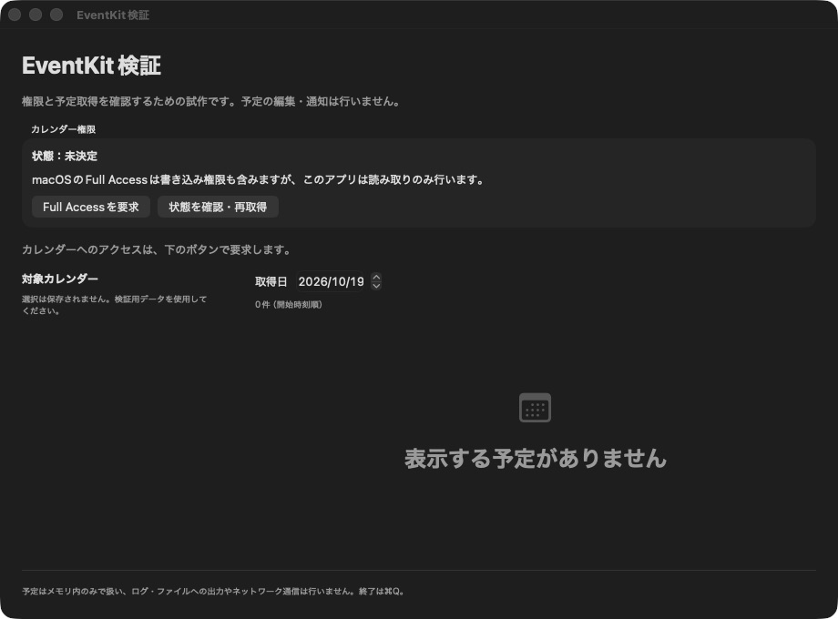

# EventKit検証

## 目的と構成

CAL-01〜03、REL-04、NFR-01〜02に関する権限・取得・変更通知・回識別の挙動を確認します。アプリは`Prototypes/EventKitProbe/`、ビルド・起動コマンドは[README](../../README.md)にあります。製品の通知機能とは独立した通常ウィンドウの試作です。

単一EKEventStoreをMainActorで扱い、ローカルタイムゾーンで選択した一日と重なる予定を取得します。カレンダーは初期未選択で、選択・日付・取得結果を永続化しません。終日予定・例外回も表示し、通知対象の絞り込みは行いません。メモ・URL・参加者は取得結果へ転記せず、会議情報のログ出力・エクスポートは実装しません。

読み取りはEventKitの同期APIをMainActor上で実行する最小構成です。大量の予定での応答性や、製品用の非同期取得・取得失敗時の復旧設計は未検証です。`events(matching:)`はエラーをthrowしないため、0件とプロバイダー側の取得失敗をこの画面だけで区別できません。

## 環境と結果

確認日：2026-10-19。

2026-10-20追記：Apple Development署名でのビルドと署名チェーンを確認。利用者が起動・Full Access許可・カレンダー選択・予定表示を確認しました。以下の初期記録に加え、EK-02とEK-03の基本取得が利用者確認済みです。終日・日跨ぎ・予定なしの個別照合、変更・削除・拒否・撤回は未実施です。

| 項目 | 条件・結果 |
| --- | --- |
| ホスト | macOS 26.6.2（25G83）、Apple Silicon |
| Xcode / Swift | 27.1（27A9275）/ 6.4（swiftlang-6.4.0.34.1） |
| SDK / Deployment Target | macOS 27.0 / 14.0。macOS 14実機は未検証 |
| Debugビルド | `xcodebuild`で成功。Swift 6言語モード・Strict Concurrency有効 |
| 署名 | Ad Hoc署名。`codesign --verify --strict`成功。有効なApple署名証明書は検出されず、Apple Development署名は未検証 |
| Sandbox | ビルド成果物のentitlementsでApp SandboxとCalendarsを確認。ネットワークentitlementなし |
| 初期画面 | 起動成功。「未決定」、予定0件、未選択、権限要求ボタンを確認。権限ダイアログは未表示 |
| 整形・スタイル | Xcode同梱`swift-format lint --strict`成功 |
| 自動テスト | XCTestターゲット未作成。実EventKitの権限と同期は以下の手動試験で検証する |

ビルド時にはホストのCoreSimulatorバージョン不一致とAppIntentsメタデータ抽出省略の診断が出ています。macOSアプリのコンパイル・リンク・署名は成功しました。

## 手動検証手順

機密情報を含まない専用テストカレンダーと予定をmacOS Calendarで用意します。アプリは予定を書き込みません。結果を記録する際は、実際のタイトル・カレンダー名・識別子・会議情報を画像やリポジトリへ含めず、識別子にはA/B等のラベルを割り当てて比較します。

権限はOSのシステム設定から操作します。署名とBundle IDを一定に保ち、変更した場合は別の検証条件として記録します。初期のAd Hoc署名はビルドと画面確認用です。権限試験ではXcodeのSigning & CapabilitiesでApple Development署名を設定し、使用したOS・署名種別を記録します。

| ID | 操作 | 期待・観測点 | 結果 |
| --- | --- | --- | --- |
| EK-01 | 未決定の状態で起動する | 自動で権限ダイアログを開かず、予定・選択は空 | 合格（Ad Hoc） |
| EK-02 | 「Full Accessを要求」を押し、許可する | OSの説明に同意後、Full Accessとカレンダー一覧を表示。自動選択なし | 未実施 |
| EK-03 | 検証用カレンダーを選び、日付を変える | 該当日の予定を開始順に表示。終日・日跨ぎ・予定なしも照合 | 未実施 |
| EK-04 | 別の検証条件で要求を拒否する | 拒否と案内を表示し、予定を取得しない | 未実施 |
| EK-05 | 表示中にシステム設定で権限を撤回し、アプリへ戻る | 拒否を表示し、予定・カレンダー・選択を破棄 | 未実施 |
| EK-06 | システム設定で再許可し、アプリへ戻る | 最新の権限と一覧を表示。カレンダーは再選択が必要 | 未実施 |
| EK-07 | macOS Calendarで予定を追加・時刻変更・削除する | 変更通知による再取得で画面を更新。同期遅延と手動更新との差も記録 | 未実施 |
| EK-08 | 単発予定を移動、繰り返しの一回だけ変更・削除、シリーズを編集する | eventIdentifier、calendarIdentifier、occurrenceDate、isDetachedの変化を比較。削除回が消える | 未実施 |
| EK-09 | 予定を別カレンダーへ移動し、アカウント再同期を試す | 識別子の変化を観測し、ADR-04の同一回対応の限界を記録 | 未実施 |
| EK-10 | 権限がrestricted / writeOnlyの環境で起動する | 読み取りせず、状態と案内を表示。状態を作れなければ未検証と記録 | 未実施 |
| EK-11 | スリープ中に予定を編集し、復帰する | 権限確認と再取得を行う。表示内容をCalendarと照合 | 未実施 |
| EK-12 | メニューから終了し、再起動する | 終了でき、自動復活しない。選択・取得結果が残らない | 未実施 |

権限撤回がOSによってプロセス終了を伴う場合は、終了自体と再起動後に予定が空になることを分けて記録します。権限変更の即時通知は仮定せず、再アクティブ化・復帰・手動更新時の検知を確認します。

## APIの根拠

確認日：2026-10-19。TN3152本文とXcode 27.1のEventKitヘッダーを確認しました。APIの存在確認と実機での成功を区別します。

- [Apple：TN3152](https://developer.apple.com/documentation/technotes/tn3152-migrating-to-the-latest-calendar-access-levels)：既存予定の参照にはFull Access、新しいUsage Descriptionと要求APIを使用。
- [Apple：EKEventStoreChangedNotification](https://developer.apple.com/documentation/eventkit/ekeventstorechangednotification)：変更通知は再取得の契機として扱う。
- [Apple：Calendars entitlement](https://developer.apple.com/documentation/bundleresources/entitlements/com.apple.security.personal-information.calendars)：Sandboxでカレンダーへアクセスするための設定。

権限要求APIのコンパイル確認は、権限許可・撤回・データ同期・識別子安定性の実機検証を代替しません。オーバーレイ・ロック解除・Login Item・性能・URLの検証は未着手です。
