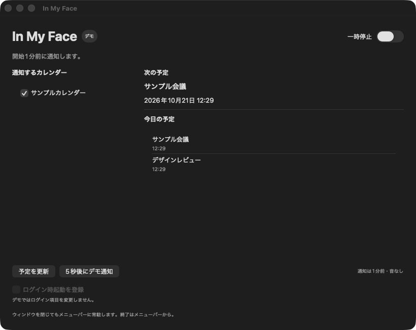

# ログイン時起動の検証

確認日：2026-10-21。macOS 26.6.2 / Xcode 27.1 / macOS SDK 27.0。最小OSのmacOS 14実機では未確認です。

## 実装と確認結果

`LoginItemService`はMainActorで`SMAppService.mainApp`の状態取得と明示操作での登録・解除を行います。起動時やOS設定からの復帰時に登録し直す処理はありません。解除中は別の変更を受け付けず、終了後にOS状態を読み直します。操作の失敗は固定のエラー文で表示します。

| 項目 | 結果 |
| --- | --- |
| Apple Development署名付きDebugビルド | 成功 |
| XCTest | 既存29件とログイン項目8件、合計37件成功 |
| 初期・外部変更の状態取得 | 差し替えたOS操作で、起動と再取得が登録・解除を行わないことを確認 |
| 登録・解除 | enabled・requiresApprovalへの遷移、二重登録抑止、承認待ちの解除を差し替えで確認 |
| 失敗・再試行 | 登録失敗後の再試行、解除失敗後の登録維持を確認 |
| 操作の多重実行 | 解除処理中の再登録抑止を確認 |
| デモ | OS状態の取得・登録・解除なし。設定画面でスイッチが無効なことを確認 |
| 開発ビルドの状態表示 | notFoundを成功扱いせず、配置先・署名の確認案内を表示することを確認 |

`swift-format lint --strict`、プロジェクトのplist検証、`git diff --check`、ローカルリンク41件の確認も成功しました。

テストはOS操作を差し替えており、実登録や次回ログインの成功を証明するものではありません。実ログイン項目を検証のために変更していません。

## 実機確認に残る項目

継続して利用する場所に配置した署名済みアプリで、次の項目を確認します。登録状態を既に持つ場合は、初期未登録とは区別して記録します。

1. 未登録からONにし、OS状態がenabledまたはrequiresApprovalとして表示されること。
2. 承認が必要な場合、明示ボタンでログイン項目の設定へ移動し、OS側で許可して戻ると表示が更新されること。
3. OS側で無効化した後、状態の再取得と再起動だけでは再登録されないこと。
4. アプリのOFF操作が承認待ちも解除し、現在のアプリは終了しないこと。
5. ONかつOSの許可後、次回ログイン・再起動で起動すること。OFFでは起動しないこと。
6. 手動終了後に自動復活しないこと。設定・Dismiss履歴が保持されること。
7. macOS 14、署名・配置先の違い、VoiceOver・キーボードでの操作。

ログイン時にも通常起動と同じ設定画面を表示します。常時復活・ログイン前起動・独自LaunchAgentは設けません。移動・削除前に登録を解除し、新しい配置先のアプリから改めて登録します。
