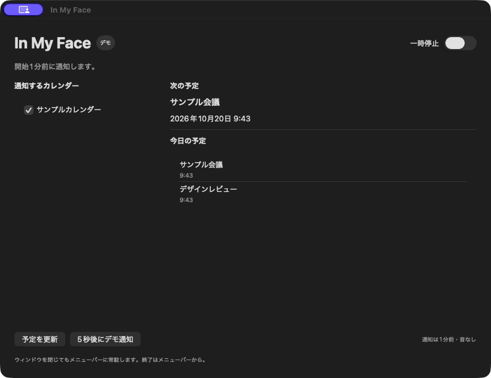
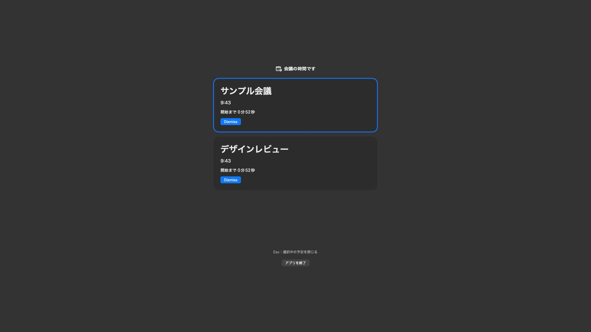

# 最小リマインダーの確認結果

## 利用できる範囲

`InMyFace.xcodeproj`は個人利用向けの初期実装です。選択したEventKitカレンダーの時間指定予定について、開始1分前に画面ごとのアラートを表示します。会議名・開始時刻・残り時間、個別Dismiss、選択中の予定を閉じるEsc、終了操作があります。表示中の予定は開始しただけでは閉じず、終了時刻に閉じます。

メニューバーから設定・当日一覧・次の予定・更新・一時停止・終了を操作できます。カレンダー選択と一時停止はUserDefaults、Dismiss履歴はApplication Support配下のJSONへ保存します。JSONには回キーと終了日時のみを保存し、タイトル・メモ・会議URLは保存しません。通信・予定の編集・独自同期・診断ログは実装しません。

通知時刻変更、Join、会議URL抽出、音、ログイン時起動は未実装です。MVP全体の完了を示すものではありません。起動方法とローカル署名設定は[README](../../README.md)を参照してください。

## 確認した環境と結果

確認日：2026-10-20。macOS 26.6.2 / Xcode 27.1（27A9275）/ Swift 6.4 / macOS SDK 27.0。Deployment Targetは14.0ですが、macOS 14実機では未確認です。

| 項目 | 結果 |
| --- | --- |
| Debugビルド | Apple Development署名で成功。SandboxとCalendars entitlementを設定 |
| XCTest | 16件成功。実カレンダーやウィンドウを使わず、固定時刻と一時ディレクトリで検証 |
| 整形・スタイル | Xcode同梱swift-formatを使用 |
| 同時通知 | カレンダーへアクセスしないデモで、実タイマーによる2件同時アラートを確認 |
| 個別Dismiss | サンプル会議を閉じた後、デザインレビューが残ることを確認 |
| Esc | 残った1件を閉じて設定画面へ戻れることを確認 |
| 再取得 | 両方のDismiss後に「予定を更新」しても再表示しないことを確認 |
| 終了 | デモをメニューから終了し、稼働アプリ一覧から消えることを確認 |
| 実予定の取得 | EventKit試作では利用者がFull Access許可・選択・表示を確認。新しい製品Bundle IDでの権限付与と実通知は未確認 |

XcodeのAppIntentsメタデータ抽出省略の警告は出ていますが、コンパイル・リンク・署名・テストは成功しています。`codesign --verify --strict`、plist検証、`swift-format lint --strict`、`git diff --check`、ローカルリンク24件・ADRの公式資料リンク14件の確認も成功しました。AGENTS.mdは33行です。端末からアプリの実行ファイルを直接起動する方法では画面確認ツールへの接続が安定しなかったため、デモはLaunch Services経由の`open --args --demo`で確認しました。

## 自動テストで確認した境界

- 1分前の直前と到来時刻、復帰時の開始後119秒と120秒、終了時刻。
- 表示済みの回を開始後2分で勝手に閉じないこと。
- 終日・キャンセル・終了済みの除外、同時刻の複数予定、重複Snapshotの排除。
- 同じ回キーのDismiss、単発の時刻編集、繰り返し回の独立性。
- 予定削除・未来への変更・時計の逆行で表示を閉じて再予約すること。
- 一時停止で表示状態を消し、再開時に古い回を遡って表示しないこと。
- 別の予定の到来を既存バッチへ追加し、未操作の予定を維持すること。
- Dismiss履歴の再読み込み、7日保持と未来へ移動した回の期限延長。
- JSON破損の警告・退避、保存失敗後もメモリ内では再表示を抑止すること。
- カレンダー選択・一時停止の再読み込み。履歴にタイトルを保存しないこと。

XCTestターゲットはモデルと純粋ロジックのソースを共有するホストなしの構成です。EventKit・権限ダイアログ・ウィンドウのOS挙動を成功と仮定するテストではありません。

## 通常利用で確認を進める項目

利用者の方針により、予定の変更・削除と権限撤回は通常利用での確認対象として残します。専用の検証を完了した扱いにはしません。製品Bundle IDでFull Accessを許可し、対象カレンダーを選ぶと通知を開始できます。

- 実会議での定刻性、変更・削除、拒否・撤回・再許可、繰り返しシリーズ・例外回の識別子安定性。
- 再起動を跨ぐ実予定の抑止、長時間稼働、大量予定でのUI応答性・負荷。
- 複数画面・画面着脱・Space・フルスクリーン・Stage Manager、キー対象の移動、VoiceOver。
- スリープ・画面スリープ・ユーザー切替・ロック・復帰、夏時間・OSの時刻変更通知。

予定取得はMainActorの同期APIです。検索範囲は当日開始または現在−2分の早い方から現在＋48時間まで、保守更新は最長30分です。EventKitの変更通知・アクティブ化・復帰・時計変更等と発火時にも再取得しますが、OSの同期遅延は制御できません。`events(matching:)`がthrowしないため、0件とプロバイダー側の一部取得失敗を区別できない制限があります。

権限がFull Access以外と判定されたら取得・予約・表示を停止し、メモリ上の予定を破棄します。設定のカレンダー識別子は再許可に備えて保持します。画面スリープ・セッション切替の通知は確実なロック状態判定ではなく、ロック中の通知を保証しません。識別子や元の回日時が変わる編集・カレンダー移動では同一回を追えず再表示する可能性があります。履歴保存失敗・破損は画面で知らせ、再起動後の抑止保証が下がることを明示します。

表示は公開APIのfloating NSPanelと`canJoinAllSpaces + fullScreenAuxiliary`を使用します。すべての他アプリ上での前面表示を保証せず、システムの表示制約を回避しません。配布前にはMust要件とOS連携の検証を完了させます。
