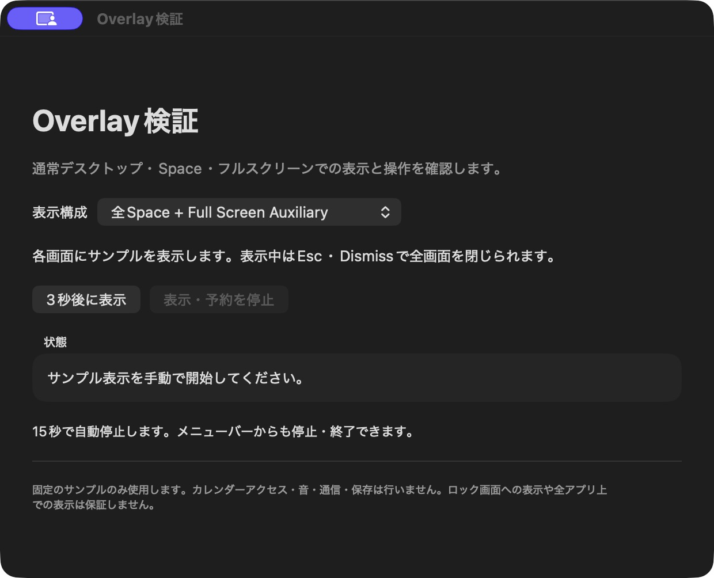
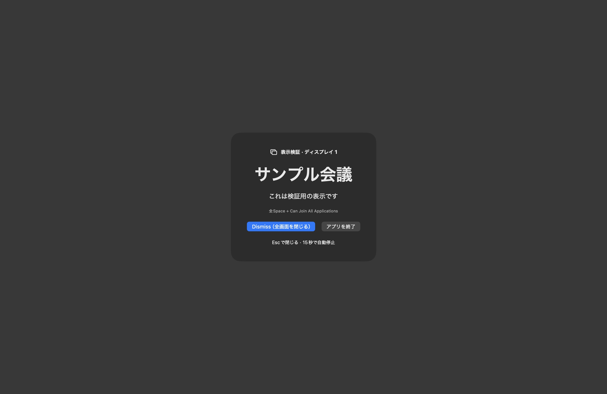

# オーバーレイ検証

## 目的と構成

ALT-02〜05、NFR-02・06について、公開APIによる表示範囲と離脱操作を確認します。アプリは`Prototypes/OverlayProbe/`、ビルド・起動は[README](../../README.md)を参照してください。カレンダー・会議URL・通知音・ログイン項目・予定のスケジューリングは扱いません。

`LSUIElement`を有効にしたメニューバー常駐の試作です。通常ウィンドウの検証画面から、固定サンプルを3秒後に表示します。各NSScreenのframe全体にborderless・nonactivatingのNSPanelを1枚作り、levelはfloatingを使います。権限要求、非公開API、イベントタップ、繰り返しのアクティブ化は使いません。

比較する構成は以下の2種類です。表示・予約中は構成を変更できません。

| 構成 | CollectionBehavior |
| --- | --- |
| A | canJoinAllSpaces + fullScreenAuxiliary |
| B | canJoinAllSpaces + canJoinAllApplications |

最初の画面を一度だけキー対象とし、別画面へのクリックでキー対象を移す方針です。いずれかの画面でEsc・Dismissを操作すると、共通状態を更新して全パネルを破棄します。表示・予約はメニューバーからも停止でき、終了操作でTaskとパネルを破棄します。検証画面を閉じてもメニューバーから再表示できます。

15秒の自動停止は検証用です。製品で開始済みの会議を勝手に閉じる仕様にはしません。スリープとユーザーセッション非アクティブ化の通知で予約・表示を停止し、復帰時に自動再表示しません。ロック・ログイン画面での挙動は未検証です。

## 確認結果

確認日：2026-10-20。macOS 26.6.2（25G83）/ Xcode 27.1（27A9275）/ Swift 6.4 / SDK 27.0。Ad Hoc署名、App Sandbox有効。Deployment Targetは14.0ですが、macOS 14では未検証です。

| 条件 | API構成 | 期待 | 実測 | 制限 |
| --- | --- | --- | --- | --- |
| 通常デスクトップ、取得したパネルはディスプレイ1 | A | サンプルとDismiss・終了を表示 | パネルと画面画像を確認 | 接続中の全ディスプレイの同時目視確認は未実施 |
| 同条件 | B | 同上 | パネルのUIを確認 | 全画面での物理的な表示確認は未実施 |
| A表示中 | A | Escで全パネルを閉じる | 検証画面へ戻り、状態がDismiss、再表示可能 | 複数画面からの操作は未検証 |
| B表示中 | B | Dismissで閉じる | 検証画面へ戻り、再表示可能 | VoiceOver・Tab移動は未検証 |
| 検証画面の停止操作 | A | 表示・予約を停止 | 停止状態と再表示可能なUIを確認 | 発火直前のキャンセル競合は未検証 |
| Bで表示後に操作せず待つ | B | 自動停止し、再表示可能 | 「15秒経過で自動停止」を確認 | タイムアウト精度の計測は未実施 |
| Bのサンプルから終了 | B | アプリとパネルを終了 | 「アプリを終了」の操作後、稼働アプリ一覧から消えることを確認 | メニューバーからの終了は未検証 |
| EventKitProbeのフルスクリーン稼働中 | B | 他アプリのフルスクリーンSpaceで表示可能か確認 | EventKitProbeのフルスクリーン状態と、生成されたサンプルパネルのUI・画像を確認 | アプリ単位の画面取得のため、OSの最終合成結果・Space移動の有無までは証明しない。前面表示の保証は未確定 |

画像はサンプルのみを含みます。フルスクリーンの一般保証や全アプリ上での表示成功を示すものではありません。

## 残りの実機マトリクス

構成A/Bのそれぞれについて「OS／アプリ版／画面構成／Space設定／前面アプリ／API構成／期待／実測／制限」を記録します。

- 対応最小OSと最新安定OS、通常Spaceと別Space、複数の他アプリのフルスクリーン。
- Stage Manager ON/OFF、ディスプレイごとの個別Space ON/OFF。設定変更は手動で実施する。
- 単一・複数ディスプレイ、表示中の画面接続・切断・解像度変更。全パネルの枠と同時表示を目視で確認する。
- 他画面のクリックによるキー対象の移動、Esc・Tab・VoiceOver、Dismiss後に元の作業へ戻れること。
- 予約中・表示中のメニューバー停止、検証画面を閉じてからの再表示、パネルとメニューバー双方からの終了、終了後の自動復活がないこと。
- 発火直前の予約キャンセル、連続表示、画面再構成と自動停止の競合、スリープ・ユーザー切替・ロック。予定に関する復帰時の救済はこの試作では扱わない。

これらは未実施です。OSが表示を許さない構成は制限として記録し、前面化の反復で回避しません。製品用AlertCoordinatorと最終的なフラグの選定はマトリクスの結果で判断します。

## ビルド・静的確認

Debugビルド、`swift-format lint --strict`、plist検証、`codesign --verify --strict`、`git diff --check`は成功しました。ビルド成果物のentitlementsでApp Sandboxのみを確認しました（Debug用get-task-allowを除く）。ローカルリンク25件とADR・本書のApple公式資料リンク14件を確認しました。XCTestターゲットは未作成です。Ad Hoc署名ではXcodeがHardened Runtimeを無効にするため、配布署名での挙動は別途確認が必要です。

ホストのCoreSimulatorバージョン不一致とAppIntentsメタデータ抽出省略の診断が出ています。macOSアプリのコンパイル・リンク・署名は成功しました。

## APIの根拠

確認日：2026-10-20。Apple公式資料の本文とXcode 27.1のAppKitヘッダーを確認しました。

- [Apple：canJoinAllApplications](https://developer.apple.com/documentation/appkit/nswindow/collectionbehavior-swift.struct/canjoinallapplications)：macOS 13以降。Stage Manager・適格なフルスクリーンへの参加を指定し、primary・auxiliaryと排他。
- [Apple：fullScreenAuxiliary](https://developer.apple.com/documentation/appkit/nswindow/collectionbehavior-swift.struct/fullscreenauxiliary)：フルスクリーンと同じSpaceへの表示方針。
- [Apple：didChangeScreenParametersNotification](https://developer.apple.com/documentation/appkit/nsapplication/didchangescreenparametersnotification)：ディスプレイ構成変更の通知。
- [Apple：sessionDidResignActiveNotification](https://developer.apple.com/documentation/appkit/nsworkspace/sessiondidresignactivenotification)：ユーザーセッション切替に関する通知。NSWorkspaceのnotificationCenterを使う。画面ロックの確実な検出とは扱わない。
